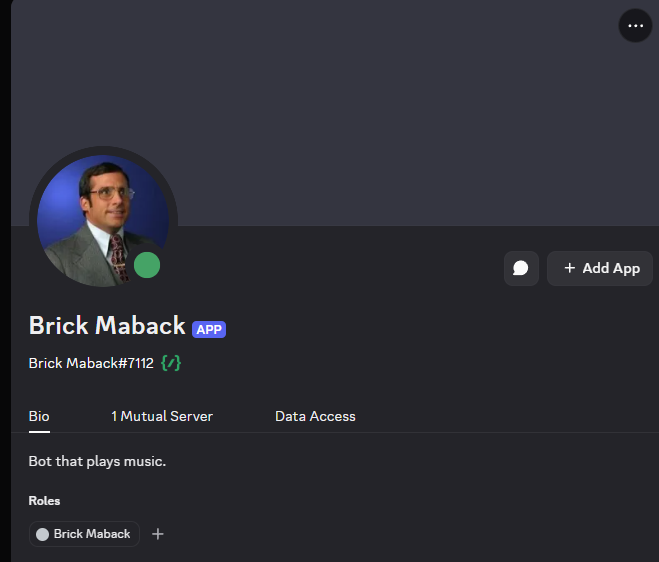

# Discord Music Bot

A self-hosted Discord bot that plays music in voice channels. Audio is played by [Lavalink](https://lavalink.dev), a separate Java server that runs next to the bot on the same machine.

**Status:** all 9 milestones built (see [AGENTS.md](AGENTS.md)). Control playback with slash commands or on the website (log in with Discord), which can be made public with Tailscale Funnel. Search for songs by name or paste links; settings are on the website, queues survive restarts, and each server can keep saved playlists and a library of uploaded audio files.

- [How it works](docs/how-it-works.md): a tour of the code, and how to add a command
- [Design](docs/design.md): the full design and the decisions behind it
- [AGENTS.md](AGENTS.md): instructions for AI coding agents (Claude Code reads it through `CLAUDE.md`)

## Meet Brick Maback



In Discord, the bot is **Brick Maback** (`Brick Maback#7112`), with the bio "Bot that plays music." He joins your voice channel when someone plays something, and leaves by himself once nobody is left listening.

His status shows what he's doing right now:

| Status | Dot | Means |
|---|---|---|
| Listening to *Song – Artist* | green | Playing that song |
| Listening to *music in 2 servers* | green | Playing in more than one server at once |
| ⏸ Paused: *Song* | green | Paused; `/resume` continues |
| Waiting for a song · /play | green | In a voice channel with an empty queue |
| Waiting for /resume: *Song* | moon | The bot restarted mid-song; `/resume` (or `/play`) picks it up again |
| Idle · /play to start | moon | Not in any voice channel |

Discord gives a bot one status for all its servers, so with several servers it sums them up (playing beats paused, paused beats waiting). The status changes at most every 5 seconds.

To show something else, the bot owner can set a **custom status** on the website's Admin page: any text, shown as it is or as "Listening to …", "Playing …", "Watching …" or "Competing in …", with a green, moon or red dot. It stays until it's switched back to **Automatic**, which brings back the table above.

His name, avatar and bio are set in the [Discord Developer Portal](https://discord.com/developers/applications): the name and avatar under **Bot**, the bio ("description") under **General Information**. To add him to another server, open the invite link from step 3 of the setup below.

## Commands

| Command | What it does |
|---|---|
| `/play <song or link>` | Joins your voice channel and plays the song, or adds it to the queue if something is already playing. Type a song's name (like `daft punk one more time`) to play the best match from YouTube, or paste a link. For a YouTube playlist link, add `playlist: True` to queue every song of the playlist (up to 500). Spotify links work too (see "Spotify links" below). Add `next: True` to put it at the front of the queue, so it plays after the current song (also works with `playlist: True` and `file:`). |
| `/play file:<attachment>` | Plays an audio file you attach, and saves it to the server's library (see below). |
| `/pause` / `/resume` | Pauses or resumes the current track. After a restart, `/resume` joins your voice channel and continues the song where it stopped. |
| `/skip` | Skips to the next track |
| `/playnow <position>` | Plays a queued track right away (its number in `/queue`), skipping the current one. The rest of the queue keeps its order. |
| `/stop` | Stops playback, clears the queue and leaves the voice channel |
| `/seek <time>` | Jumps to a point in the current track, like `1:30` or `90` (seconds) |
| `/queue` | Shows the current track, what's coming up, the volume and the loop mode |
| `/remove <position>` | Removes a track from the queue (positions are the numbers in `/queue`) |
| `/move <from> <to>` | Moves a track to a different place in the queue (`to: 1` plays it next) |
| `/shuffle` | Shuffles the queue; the current track keeps playing |
| `/loop off\|track\|queue` | Repeats nothing, the current track, or the whole queue |
| `/volume [percent]` | Shows or sets the volume, 0–150% (100 is normal). Goes back to the server's starting volume when the bot leaves. |
| `/normalize on\|off` | Volume normalization, like Spotify's "Normalize volume": every song plays at about the same loudness, so a loud song after a quiet one isn't a shock. Stays on for the server (also after restarts) until switched off. Needs ffmpeg. |
| `/announce <text>` | Says the text in your voice channel (text-to-speech, up to 300 characters). The song pauses while the bot speaks, then carries on from the same spot. The website's Player tab has the same thing: the **Announce** box. Needs Piper (`npm run setup:piper`). |
| `/filter <effect>` | Adds an audio effect: nightcore, vaporwave, bassboost, 8d, karaoke or soft (`off` removes it). One at a time; it stays on for the next songs until changed or the bot leaves. |
| `/playlist ...` | This server's saved playlists; see below |
| `/library ...` | This server's uploaded audio files; see below |

The bot leaves the voice channel by itself, clearing the queue, after being alone in it for 60 seconds (changeable per server).

### Spotify links

Spotify doesn't let bots play its music, so for a Spotify link the bot reads the song's artist and title from Spotify and plays the best match from YouTube Music, the same as typing the song's name. No Spotify account or keys are needed.

- **A song** (`https://open.spotify.com/track/...`): works everywhere a link does: `/play`, "Add a song", `/playlist add`.
- **An album or playlist** (`.../album/...`, `.../playlist/...`): `/play` and "Add a song" always queue all of its songs; `/playlist import` and the website's import copy them into a saved playlist. Each song is looked up on YouTube, about 15 seconds for 100 songs. Spotify only shows the bot the first 100 songs of a playlist.
- The YouTube video that was found is what gets queued or saved, so the song can't change later.

### Playlists

Each server has its own saved playlists. Songs are saved as links, so a playlist never goes stale: each song is loaded when it plays. Discord suggests playlist names as you type.

| Command | Who | What it does |
|---|---|---|
| `/playlist list` | everyone | The server's playlists, with song counts and lengths |
| `/playlist show <name>` | everyone | The first 15 songs of a playlist (the website shows all of them) |
| `/playlist add <name> <link>` | everyone | Adds a song to the end of a playlist: a link, or a song's name to search for |
| `/playlist remove <name> <position>` | everyone | Removes a song (positions are the numbers in `/playlist show`). DJs can remove any song; everyone else only the songs they added. |
| `/playlist play <name> [mode]` | DJs | **Replaces** the queue with the playlist: the current song stops and the playlist starts from the top. With `mode: add to queue`, the songs go to the end of the queue instead. |
| `/playlist create <name>` | DJs | Creates an empty playlist |
| `/playlist import <name> <link>` | DJs | Copies a YouTube playlist's songs (up to 500), or a Spotify album's or playlist's (up to 100), into a playlist, creating it if there's none with that name. Takes a few seconds; Spotify ones up to half a minute. |
| `/playlist save <name>` | DJs | Saves the current song and the queue as a new playlist |
| `/playlist delete <name>` | DJs | Deletes a playlist |

Names can be up to 50 characters, are unique per server, and upper/lower case doesn't matter (`chill` finds "Chill"). A playlist holds at most 500 songs. The server's queue limit and longest-song setting apply when a playlist is played: songs that don't fit or are too long are left out, and the reply says how many.

### Library

Each server has a library of audio files people uploaded: the fallback for when YouTube and the other sites break, or for music that isn't online at all. Files are added with `/play file:` or `/library upload` in Discord, or on the website's **Library** tab (better for big files: free Discord accounts can only attach about 10 MB).

| Command | Who | What it does |
|---|---|---|
| `/library list [search]` | everyone | The library's files (the first 15, or those matching the search), and how much space they use |
| `/library play <file>` | DJs | Plays a file from the library, or adds it to the queue. Discord suggests files as you type. |
| `/library upload <file>` | uploaders | Saves an attached file to the library without playing it |
| `/library delete <file>` | DJs | Deletes a file from the library |

Who counts as an uploader is a server setting (DJs by default; see Settings below). Most audio formats work: MP3, FLAC, WAV, OGG/Opus, M4A and WebM play as they are, and anything else ffmpeg can read (WMA, AIFF, 24-bit WAV, even videos) is converted to Opus when it's added. The title and artist come from the file's tags, or else from its file name. The owner sets the largest file and how much space each server gets (100 MB per file and 2000 MB per server to start with) on the Admin page.

**Who can use what:** `/queue` and the `/playlist` and `/library` commands marked "everyone" are for everyone; the other commands are for DJs. Server admins (Administrator or Manage Server) and the bot owner (`OWNER_ID`) can always do everything. **Until a server admin picks a DJ role on the website's Settings tab, nobody else is a DJ.** Pick `@everyone` there to let every member control playback.

**After a restart** (including every save while `npm run dev` runs), the bot remembers each server's song, position, queue, loop mode, effect and recently played list. If people are still in its voice channel, it rejoins and carries on from where it stopped. Otherwise the song waits, paused, until someone uses `/resume` or `/play`.

Supported links: YouTube, SoundCloud, Bandcamp, Twitch, Vimeo, direct audio file URLs, and most other sites [yt-dlp supports](https://github.com/yt-dlp/yt-dlp/blob/master/supportedsites.md).

Anything that isn't a link is searched for on YouTube, and the best match is queued: YouTube Music first (it finds the song itself rather than a music video with an intro), then plain YouTube if that finds nothing. The reply shows which song was found; if it's the wrong one, `/skip` it and add the artist's name to the search, or paste a link.

Links are played through Lavalink when it can. When it can't (YouTube blocks Lavalink's plugin every now and then, and SoundCloud is broken in Lavalink 4.2.2), the bot downloads the song with [yt-dlp](https://github.com/yt-dlp/yt-dlp) instead. That takes about 10 seconds, so expect a short pause on those songs.

## Setup (Windows)

### 1. Install the prerequisites

You need Node.js (LTS), Java 17 or newer, and ffmpeg (for checking and converting files added to the library).

```
winget install OpenJS.NodeJS.LTS EclipseAdoptium.Temurin.21.JDK Gyan.FFmpeg
```

### 2. Install the project

```
npm install
npm run setup:lavalink
npm run setup:ytdlp
npm run setup:piper
```

- `setup:lavalink` downloads `lavalink/Lavalink.jar`. Lavalink downloads its YouTube plugin by itself the first time it starts.
- `setup:piper` downloads Piper, the offline text-to-speech program behind `/announce`, into `bin/piper/` (about 85 MB with its voice). Nothing you type for announcements leaves your PC. It downloads one voice (Lessac, American English); more English, German and Latvian voices can be downloaded on the Admin page later. Japanese, Chinese, Russian and other titles are read the way they'd be spelled in Latin letters (夜に駆ける as "yoru ni kakeru"), with the voice's accent.
- `setup:ytdlp` downloads yt-dlp into `bin/`. The bot updates it on every start, because YouTube changes often break old versions. (A system-wide yt-dlp also works if `bin/` has none.)

### 3. Create the Discord application

1. Go to the [Discord Developer Portal](https://discord.com/developers/applications) and create an application.
2. Under **Bot**, click **Reset Token** and copy the token.
3. Under **OAuth2 → URL Generator**, tick the scopes `bot` and `applications.commands`, then the permissions View Channels, Connect, Speak, Send Messages and Embed Links. Open the generated URL to invite the bot to your server.
4. For the website's "Log in with Discord": under **OAuth2**, click **Reset Secret** and copy it, and under **Redirects** add `http://localhost:3000/api/auth/callback` (with your `PUBLIC_URL` instead of `http://localhost:3000` once the site is public).

### 4. Fill in `.env`

Copy `.env.example` to `.env` if you don't have one yet, then fill in:

| Variable | Where to find it |
|---|---|
| `DISCORD_TOKEN` | The bot token from step 3 |
| `DISCORD_CLIENT_ID` | Developer Portal → your app → **General Information** → Application ID |
| `DISCORD_CLIENT_SECRET` | The secret from step 3.4 |
| `SESSION_SECRET` | A long random string that signs login cookies. Generate one with `node -e "console.log(require('crypto').randomBytes(32).toString('hex'))"` |
| `OWNER_ID` | Your own Discord user ID (Developer Mode on → right-click yourself → Copy User ID). You can do everything, everywhere. |
| `LAVALINK_PASSWORD` | Any long random string. The bot and Lavalink both read it from here. |
| `DEV_GUILD_ID` (optional) | Your server's ID (turn on Developer Mode in Discord, right-click the server → Copy Server ID). Slash commands then register only in that server and show up there instantly, but disappear from your other servers until you empty it again. |

`WEB_PORT`, `PUBLIC_URL` and `OAUTH_REDIRECT_URI` can stay as they are while the website runs on your own computer.

## Running

You need two terminals: one for Lavalink, one for the bot.

```
npm run lavalink
```

Wait for `Lavalink is ready to accept connections`, then:

```
npm run dev
```

`dev` restarts the bot whenever you save a file. When you see `logged in as ...` and `node "main" connected`, join a voice channel and run `/play` with a YouTube link.

### The website

While the bot runs, open **http://localhost:3000** (or whatever `WEB_PORT` is) and log in with Discord. You see the servers you share with the bot; with more than one, pick one at the top. Everything updates live as things change in Discord.

The **Player** tab starts with the current song, artwork, progress and playback controls. Expand **Audio effects** below the controls to pick an effect; the current effect is visible while it's closed. Type a song's name or paste a link under **Up next** to add a song. Long queues scroll inside their list, keeping the player and add-song form above them. **Recently played** sits beside the queue on wide screens and below it on smaller screens. The light theme uses soft green-tinted surfaces to distinguish the player and lists. The page follows your system's light or dark theme; the sun/moon button at the top right switches it, and your browser remembers the choice (switching back to your system's theme follows the system again).

- **Everyone** sees the current song with its progress bar, the active effect, the queue, and the recently played songs. Click a song's title to open it on YouTube (or wherever it's from) in a new tab.
- **DJs** also get the controls: add a link, pause/resume, skip, stop, drag the progress bar to seek, volume, loop, **Audio Normalization** (the same as `/normalize`), effects, reorder queued songs by dragging them (or with ↑↓; dragging doesn't work on most phones), play a queued song right away (**▶**, skips the current one), remove queued songs, shuffle, clear the queue (the current song keeps playing), and the **+** button on recently played songs to add them to the queue again, or clear that list.
- Adding a song from the website joins the voice channel you're in, like `/play`. When you paste a link from a YouTube playlist, a checkbox offers to add the whole playlist. A Spotify album or playlist link always adds all of its songs. **Play next** (beside **Add to queue**) puts the new song, or all of a playlist's songs in order, at the front of the queue, so it plays after the current song.
- The **Library** tab (everyone) lists the server's uploaded files, with a search box, how much space they use, and who uploaded each. Uploaders (DJs, unless a server admin changed it) get **Upload audio files**: pick one or more files and they upload one after another, with a progress bar. DJs also get **+** to add a file to the queue and **✕** to delete it.
- The **Playlists** tab (everyone) lists the server's playlists; click one to see its songs. Everyone can add songs and remove the ones they added. DJs also get **Play** (replaces the queue; it asks first if something is queued), **Add to queue**, dragging (or ↑↓) to reorder, remove any song, **Rename**, **Delete**, a "New playlist" form (empty, or imported from a YouTube playlist link) and **Save the queue as a playlist**. Changes show up live for everyone, including ones made in Discord.
- **Server admins** get a **Settings** tab for that server:

  | Setting | What it does |
  |---|---|
  | DJ role | Who may control playback. No DJ role = only admins; `@everyone` = every member. |
  | Only from the bot's voice channel | DJs must be in the bot's voice channel to control it (admins don't). Off by default. |
  | Starting volume | The volume the bot joins at (default 100%). |
  | Queue limit | The most songs that can wait in the queue (default: no limit). |
  | Longest song | Longer songs can't be added; livestreams are always allowed (default: no limit). |
  | Leave an empty channel after | How long the bot stays alone in voice before leaving (default 60 s; 0 = never). |
  | Announce songs in | A text channel where the bot posts "Now playing …" for every new song (default: off). |
  | Who can upload to the library | DJs (and admins), only admins, or nobody (default: DJs). |
  | Voice and speaking speed | The voice for announcements (from the voices the bot owner downloaded) and how fast it speaks, 0.5× to 2×. **▶ Listen** plays a sample in your browser. With a German or Latvian voice, write the messages below in that language too. |
  | Spoken announcements | Things the bot says by itself in its voice channel, each switched on separately with its own message (all off by default): **before a song** ("Now playing {song}, requested by {user}."), for every song or only when the music starts after nothing was playing; **when a playlist starts**; **when someone joins** ("Welcome, {name}!"); **when someone leaves**. Words in `{curly brackets}` are filled in; under each message the page lists the ones it can use. People joining or leaving together are named together, and someone hopping in and out isn't announced again within a minute. Needs Piper, like `/announce`. |

- **You (the bot owner)** also get an **Admin** button at the top: how YouTube links are loaded (automatic, only Lavalink's plugin, or only yt-dlp), whether yt-dlp updates on every start, an "Update now" button for yt-dlp, the largest library upload and the library space per server, Brick Maback's Discord status (automatic, or a custom one), the **Voices** list (download or delete the voices servers can choose for announcements; about 63 MB each), and the status of the bot, Lavalink, yt-dlp and ffmpeg, plus the Discord status he shows right now.

Settings apply right away; there's nothing to restart.

With `npm run dev`, edits to `web/` show up in the browser immediately. The website is only reachable from your own computer until you make it public (next section).

### Making the website public (Tailscale Funnel)

[Tailscale Funnel](https://tailscale.com/kb/1223/funnel) gives this PC a fixed public address like `https://my-pc.tail1234.ts.net`, for free, so friends can open the website and log in from anywhere. The website is only public while `npm run funnel` runs; Ctrl+C makes it private again.

**Once:**

1. Install Tailscale (`winget install Tailscale.Tailscale`), open it from the taskbar and log in.
2. Run `npm run funnel`. It prints the PC's public address. The first time, Tailscale prints a link instead, to switch Funnel (and HTTPS certificates) on for your tailnet: open it, allow it, and run `npm run funnel` again.
3. In `.env`, set `PUBLIC_URL` to that address and `OAUTH_REDIRECT_URI` to the address plus `/api/auth/callback`, e.g.
   ```
   PUBLIC_URL=https://my-pc.tail1234.ts.net
   OAUTH_REDIRECT_URI=https://my-pc.tail1234.ts.net/api/auth/callback
   ```
4. In the Discord Developer Portal → your app → **OAuth2** → **Redirects**, add that callback address. Keep the `http://localhost:3000/...` one: logging in on this PC (at http://localhost:3000) keeps using it, so it works while the public address is off.

**Every time** you want friends to use the website, use three terminals:

```
npm run lavalink
npm run build      (only after the code changed)
npm start
npm run funnel
```

Use `npm start` (the built website) rather than `npm run dev` while it's public: the development website only opens on this PC, and shows everyone else a message saying so, because Vite's development server could hand out the project's files. `npm run funnel` warns if `PUBLIC_URL` in `.env` doesn't match the address Tailscale gave the PC.

Other scripts:

| Script | What it does |
|---|---|
| `npm run typecheck` | Checks the TypeScript (bot and website) for errors without running anything |
| `npm test` | Runs the automated tests (`src/**/*.test.ts`, with Node's built-in test runner) |
| `npm run build` | Compiles the bot to `dist/` and the website to `web/dist/` |
| `npm start` | Runs the compiled build (use this instead of `dev` for day-to-day hosting, and always while the website is public; run `npm run build` first) |
| `npm run funnel` | Makes the website public through Tailscale Funnel until you press Ctrl+C (see "Making the website public") |

## Troubleshooting

- **"npm.ps1 cannot be loaded because running scripts is disabled"** in PowerShell: Windows blocks PowerShell scripts by default. Either run `npm.cmd run ...` instead of `npm run ...`, or allow local scripts once with `Set-ExecutionPolicy -Scope CurrentUser RemoteSigned` (or use Command Prompt instead of PowerShell).
- **`npm install` fails at `better-sqlite3` with "Could not find any Visual Studio installation"**: npm tries to compile the database library from source even though it ships a ready-made Windows build. Skip the compile step with `npm install --ignore-scripts`, then run `npm rebuild esbuild` (the one package that does need its install step).
- **`Invalid .env`** when starting: the message lists which variables are missing.
- **"The audio server (Lavalink) isn't connected"**: Lavalink isn't running, or `LAVALINK_PASSWORD` / `LAVALINK_PORT` don't match. Start it with `npm run lavalink` (not `java -jar` directly), because that script passes the password from `.env`. The bot keeps retrying every 5 seconds, so there's no need to restart it.
- **New slash commands don't show up**: the Discord app caches the command list. Press **Ctrl+R** in Discord to reload it (or fully quit and reopen it). If they're still missing, check the bot's console for `registered N global commands`. Setting `DEV_GUILD_ID` makes updates instant in that one server.
- **"YouTube refused to play this video"** (the title loads, then playback fails): YouTube regularly blocks the clients Lavalink's YouTube plugin pretends to be. The bot's console shows which clients failed and why. The usual fix is a newer plugin version in `lavalink/application.yml` (see [youtube-source releases](https://github.com/lavalink-devs/youtube-source/releases)), or changing the order of `clients` there, then restarting Lavalink. The comments in that file record what was tested last.
- **"yt-dlp isn't installed"**: run `npm run setup:ytdlp`.
- **"Text-to-speech isn't set up on the bot's computer"**: run `npm run setup:piper`. If it's set up and announcements still fail, the bot's console shows Piper's own error after `[tts] Piper failed:`.
- **Some songs take ~10 seconds to start**: those are being downloaded with yt-dlp because Lavalink couldn't load them. The console shows `[resolver] lavalink couldn't load ...` or `[player] lavalink couldn't play ...` with the reason.
- **An error starting with "yt-dlp:"**: yt-dlp couldn't get the song either; its message usually says why (private video, region-locked, removed). If YouTube songs that should work fail this way, restart the bot so it updates yt-dlp.
- **The website doesn't load**: check the bot's console. `[web] website running at ...` means it's up; `[web] the website couldn't start` says why (often another program already uses port 3000; change `WEB_PORT` in `.env`). The Discord side keeps working either way.
- **"The website hasn't been built yet"** with `npm start`: run `npm run build` first.
- **Discord says "Invalid OAuth2 redirect_uri"** when logging in: on this PC, `http://localhost:3000/api/auth/callback` must be listed under OAuth2 → Redirects in the Developer Portal; through the public address, `OAUTH_REDIRECT_URI` must be (exactly, e.g. `https://my-pc.tail1234.ts.net/api/auth/callback`).
- **Friends see "The bot's website is running in development mode"**: the bot runs with `npm run dev`, whose website only opens on this PC. Stop it and run `npm run build`, then `npm start`.
- **`npm run funnel` says "Tailscale isn't connected"**: open Tailscale from the taskbar and log in (or run `tailscale up`).
- **`npm run funnel` prints a link to "enable Funnel"**: Funnel isn't switched on for your tailnet yet. Open the link, allow it, and run `npm run funnel` again.
- **The public address doesn't load at all**: is `npm run funnel` still running, and the bot too? The first visit after switching Funnel on can take a minute while Tailscale gets the HTTPS certificate.
- **Logging in through the public address goes back to localhost**: `PUBLIC_URL` / `OAUTH_REDIRECT_URI` in `.env` are still the localhost ones. Set them as described in "Making the website public", then restart the bot.
- **The public website doesn't show the latest changes**: `npm start` runs the last build. Run `npm run build` and restart it.
- **A search plays the wrong song**: add the artist's name, or paste the song's link instead.
- **"Discord didn't accept the login"**: `DISCORD_CLIENT_SECRET` is wrong or was reset; copy the current one from the Developer Portal.
- **A role change doesn't apply on the website right away**: the website rechecks your roles at most every 30 seconds. (Changing which role is the DJ role applies at once.)
- **Friends get "You need to be a DJ"**: the server has no DJ role yet, so only admins can control playback. A server admin opens the website → the server → **Settings** → DJ role, and picks a role (or `@everyone`).
- **"Join the bot's voice channel (…) to control playback"**: the server's "Only from the bot's voice channel" setting is on. Join that channel, or ask an admin to turn the setting off.
- **"Playback stopped when the bot restarted"**: the bot restarted while nobody was in its voice channel (or the song was paused). Use `/resume` (or Resume on the website) from a voice channel to carry on.
- **"That isn't a playlist link"** / **"That isn't a YouTube playlist link"**: importing needs a YouTube link with `list=` in it, like `https://www.youtube.com/playlist?list=...` or a video opened from a playlist, or a Spotify album or playlist link.
- **A Spotify song plays the wrong version** (a live version, a cover): the bot plays YouTube's best match for the artist and title. Search for the song by name with more detail, or paste the YouTube link instead.
- **"N songs weren't found on YouTube"** after adding a Spotify playlist: YouTube had no match for those songs, so they were left out. The bot's terminal lists which ones.
- **Only 100 songs of a Spotify playlist were added**: Spotify only shows the bot the first 100. Split the playlist in Spotify, or import it in parts.
- **"Spotify says that playlist doesn't exist"**: it's private. Make it public in Spotify.
- **"spotify.link short links aren't supported"**: open the link in a browser and paste the `https://open.spotify.com/...` address it goes to.
- **Every Spotify link fails** with an error saying Spotify's embed page looks different: Spotify changed its page. The fix goes in `src/player/resolvers/spotify.ts`.
- **"That's a YouTube mix made for your account"**: personal mixes (Replay Mix, My Supermix, Discover Mix…) exist only for you while signed in, and the bot isn't signed in to YouTube. In YouTube Music, open the mix → ⋮ → **Save to playlist**, make that playlist Public or Unlisted, and import it. Mixes started from a song (a link with both `v=` and `list=RD…`) work as they are.
- **"YouTube says that playlist doesn't exist"**: it's private (or was deleted). Set it to Public or Unlisted in YouTube.
- **An import has fewer songs than the YouTube playlist**: private and deleted videos are skipped, and at most 500 songs are read.
- **Volume normalization does nothing**: it needs ffmpeg (see the next point); the bot's terminal shows `[loudness] ffmpeg couldn't measure the song` when it's missing. Livestreams and Twitch play unadjusted. A song is measured the first time it plays (about a second); if that takes longer than 3 seconds, that one play is unadjusted and the next one isn't.
- **"ffmpeg isn't installed on the bot's computer"** when adding a file: install it (`winget install Gyan.FFmpeg`), then restart the bot from a new terminal, so it sees the updated PATH. The Admin page shows whether the bot finds ffmpeg.
- **"That file isn't audio, or it's damaged"** / **"That file has no sound in it"**: ffmpeg couldn't find any sound in the file. Check that it plays on your computer.
- **"The library is full"**: the server's files use up its space. Delete some on the Library tab (or with `/library delete`), or raise "Library space per server" on the Admin page.
- **"That file is too big"**: raise "Largest upload" on the Admin page. Big files are better uploaded on the website than in Discord, which limits attachments to about 10 MB for free accounts.
- **"That file was deleted from the library"**: a queued (or playlist) song was a library file that has since been deleted. The queue moves on.
- **Uploads are refused even for admins**: the server's "Who can upload to the library" setting is "Nobody". Change it on the Settings tab.
- **Start completely fresh** (forget all settings, queues, history, playlists and the library): stop the bot and delete `data/bot.db` (and `bot.db-wal` / `bot.db-shm` next to it, if present) and the `data/library` folder. They're recreated on the next start.
- Lavalink's own logs are in `lavalink/logs/`. Downloaded songs are kept in `data/ytdlp-cache/` (the 20 most recent) and deleted when the bot starts. Library files are in `data/library/<server id>/`, named by random ids; their titles are in the database.

## Project layout

```
src/
  index.ts              Starts everything: config → database → Lavalink → Discord bot → website
  config.ts             Reads and checks .env
  permissions.ts        Who may do what (owner, admin, DJ, member), for commands and the website
  db/
    database.ts         Opens data/bot.db (SQLite)
    migrations.ts       Creates and updates the tables
    settingsStore.ts    Global and per-server settings
    playerStateStore.ts Each server's saved song, position, queue and history
    playlistStore.ts    Each server's saved playlists and their songs
    libraryStore.ts     Each server's library files (the audio itself is on disk, in data/library/)
  bot/
    client.ts           The discord.js client
    commands/           One file per slash command
    events/             Discord event handlers (ready + rejoining after a restart, slash commands, playback messages)
    voice.ts            Counts the people in a voice channel
    presence.ts         Brick Maback's status ("Listening to …", "Idle · /play to start")
    format.ts           Formatting helpers for Discord messages
  player/
    PlayerManager.ts    The one entry point for playback; commands call this
    GuildPlayer.ts      One server's current track and queue
    lavalink.ts         Connection to the Lavalink server
    resolvers/          Turns a link into a track Lavalink can play (through Lavalink, or a yt-dlp download); reads Spotify links
    filters.ts          Applies the audio effects (the list itself is in src/shared/filters.ts)
    errors.ts           UserError: errors whose message is shown to users
  tts/
    speech.ts           Text-to-speech for announcements: runs Piper to turn text into a WAV file
    spelling.ts         Spells Japanese, Chinese and other foreign writing in Latin letters, so the English voice can read it
    messages.ts         Fills in the {words} of automatic announcements
  playlists/
    PlaylistManager.ts  Saved playlists: create, edit, import from YouTube, play (both /playlist and the website use it)
  library/
    LibraryManager.ts   The library: adding files (check, convert, store), deleting, queuing (/play file:, /library, the website)
    ffmpeg.ts           Runs ffprobe (is it audio? how long? tags) and ffmpeg (converting to Opus)
    paths.ts            Where library files live on disk
  web/
    server.ts           Starts the website: REST API, Socket.IO and the React app on one port
    requests.ts         isLocalRequest(): whether a request came from this PC or through the public address
    routes/             REST API routes (under /api): auth.ts (login), guilds.ts (read), player.ts (controls),
                        playlists.ts (the Playlists tab), library.ts (the Library tab and uploads),
                        settings.ts (a server's settings), admin.ts (the owner's Admin page)
    session.ts          The signed login cookie
    access.ts           requireGuildAccess(): the permission check every server route starts with
    http.ts             route(): turns errors into HTTP answers
    socket.ts           Pushes PlayerManager's events to browsers
    frontend.ts         Serves the React app (Vite in development, web/dist in production)
  shared/               Types and helpers used by both the bot and the website
web/                    The React website (Vite)
  src/App.tsx           The page: login, server picker, the server's Player, Playlists, Library and Settings tabs, the Admin page
  src/components/       AddSong, NowPlaying (+ SeekBar, PlayerControls), EffectPicker, QueueList, HistoryList,
                        PlaylistsPage (+ PlaylistView), LibraryPage, GuildSettingsForm, AdminPanel
  src/api.ts            One function per REST call
  src/useGuildState.ts  Live state from the bot over Socket.IO
lavalink/
  application.yml       Lavalink settings (sources, YouTube plugin)
scripts/                Helpers for downloading Lavalink and yt-dlp, starting Lavalink, and Tailscale Funnel
bin/                    yt-dlp (downloaded, not in git)
data/bot.db             Settings, queues, history, playlists and the library's file list (SQLite, not in git)
data/library/           Library files, one folder per server (not in git)
data/ytdlp-cache/       Songs downloaded by yt-dlp (not in git)
docs/                   Longer explanations
```
